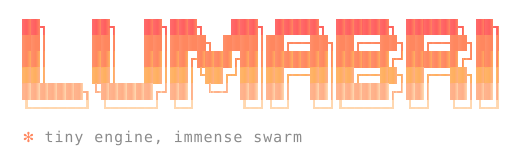
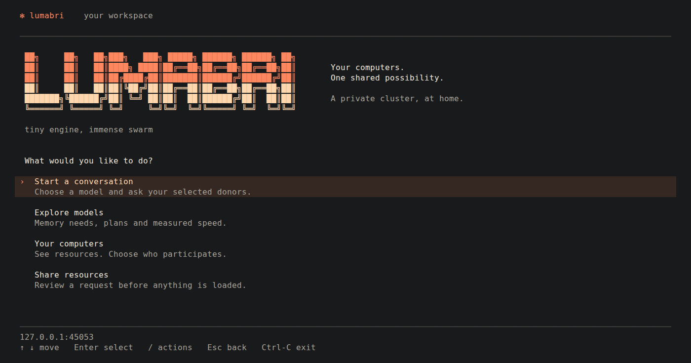
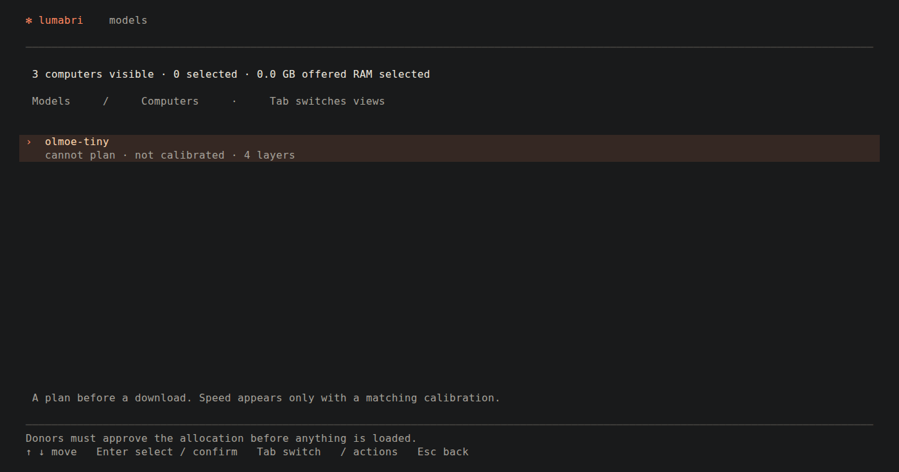
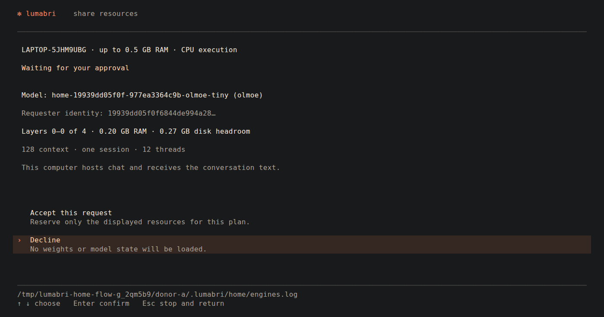
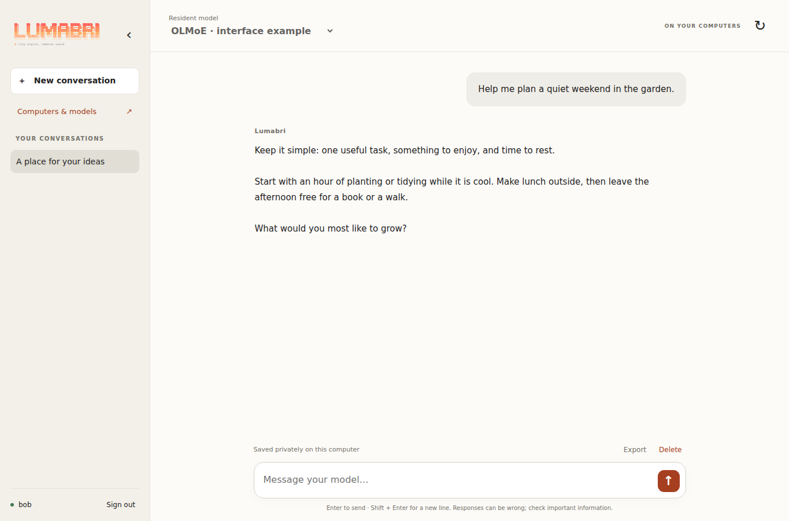
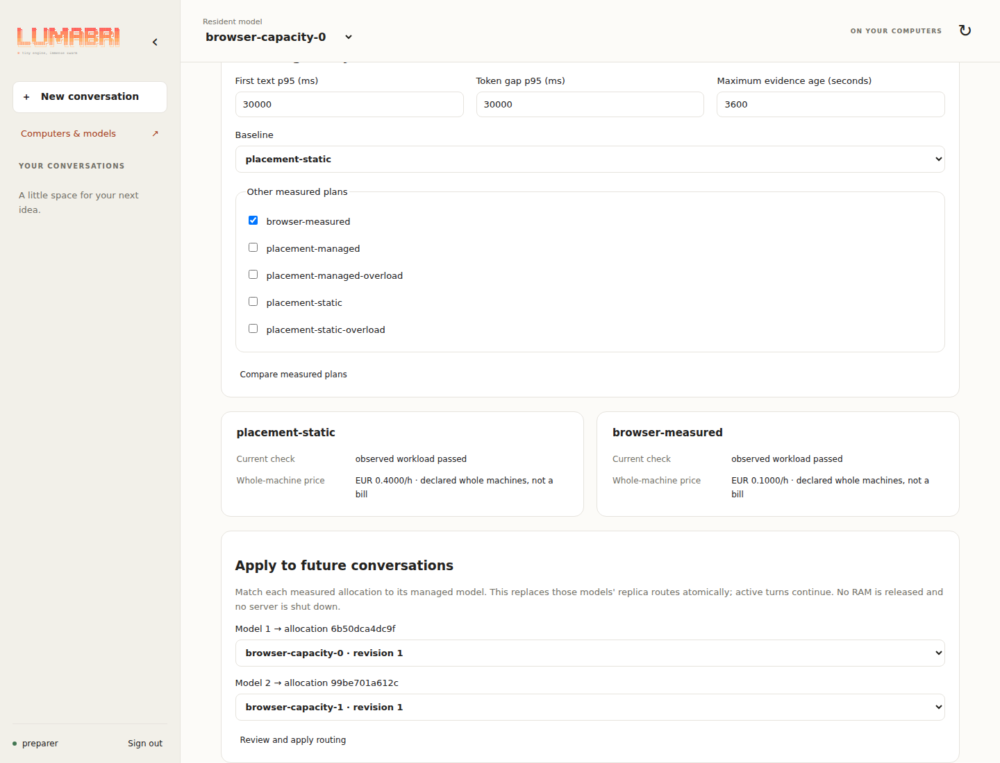

# Your computers. Your models.

Lumabri runs a private inference service across your computers, powered by
[Colibri](https://github.com/JustVugg/colibri). Choose models, select the
computers that may help, and approve how their memory is used. Chat from the
terminal or the bundled web page. The controller, terminal interface and
inference integration are written in C; the browser uses bundled HTML/CSS/JS.

**A worker does not need its own complete copy of the model.** In the resident
Segment path, it loads the weights for its assigned layers, plus any shared
state required by the adapter. Conversation state stays with the nodes that
execute those layers. A complete source checkpoint may still live on the
requesting computer; distributing its weights does not duplicate it in every
worker's RAM.

- Run supported models that do not fit on one computer by sharing the work.
- Keep several approved models resident within explicit memory budgets.
- See computers, allocations and measured workloads in one local workspace.

More computers can add usable memory and capacity. They do not guarantee more
tokens per second for each chat. Lumabri measures performance rather than
promising that every additional device makes inference faster.



## Start here

Build from source with a compatible Colibri checkout:

```sh
make ENGINE=/path/to/colibri/c
./lumabri
```

After launch, use **arrow keys and Enter**. Press **/** for workspace actions
and **Esc** to go back. Use a terminal at least 60 columns by 28 rows.

1. On one computer, open **/ → /create**. Its household service runs in the background.
2. On your other computers, open **/ → /join**. Select the household found
   on your LAN, compare its identity with **/create** on the owner computer,
   then enter the household key. Manual address entry remains available.
   Only share that key with your household.
3. Open **/settings** to set the maximum RAM you offer. Choose
   **Share resources** on each computer that may participate.
4. On the requesting computer, set **/settings** to the folder containing
   your existing Colibri model directories. Set the **context tokens** for
   new plans there too (default 512): longer conversations need more memory.
   This setting does not resize models that are already running.
5. Open **Your computers**. Press Enter to select donors; none is selected
   automatically. Tab switches to **Models**.
6. Choose a model and review its plan. Enter requests approval from the
   participating donors. Chat starts only after all approve and the complete
   chain is ready.

The creating computer saves its key and restarts its household when Lumabri
reopens. The tracker uses **TCP 47300**, household services use **TCP
47301–47315**, and LAN discovery uses **UDP 47300**. Restarting does not require
opening another random port. If the fixed range is occupied, Lumabri reports
the conflict instead of silently choosing ports outside it.

The computers still need direct LAN connectivity. On Windows with mirrored
WSL networking, open **/network** on the Windows computer: after your explicit
approval and the Windows administrator prompt, it allows only those ports
from the detected private subnet. The firewall stays enabled. The same action
can remove Lumabri's rules. Keep the `tools` folder beside the built binary.
Other systems use their normal firewall permissions. Guest Wi-Fi isolation,
VPN routing and WSL NAT mode can still prevent direct discovery or connections;
the helper does not reconfigure those networks. If your LAN address changes,
use **/join** to rediscover the household rather than guessing an address.

For an advanced multi-interface setup (for example, a VPN or Tailscale), start
the household owner with `LUMABRI_ADVERTISE=100.101.102.103 ./lumabri`, replacing
the example with that computer's reachable IPv4 address. Use the same override
on later starts; Lumabri saves the announced tracker endpoint in `home.conf`.
Join that exact endpoint on the other computers. The value is an IPv4 address
without a port, not a hostname. This does not configure VPNs or firewall rules.
An address mismatch is rejected explicitly; it does not bypass household
authentication or donor approval. Reopened TUIs restore their saved household key.

Apple Terminal uses a compatible 256-colour palette with a contrasting
selection background. Other terminals use detected colour support. For
diagnostics, `LUMABRI_COLOR=16`, `256`, `truecolor` or `none` overrides detection;
`NO_COLOR=1` disables the canvas colours. Normal use needs no colour command.

## A plan before a download



The catalogue reads the model folders and the household inventory. It shows
offered RAM, detected hardware, placement and missing resources. **Not
calibrated** means there is no matching speed measurement—not zero speed.
A detected GPU is not a promise that this execution path uses it.

For an optional short measurement, select your computers and model, open
**/ actions → /calibrate**, then review and confirm. Donors still approve the
plan. Lumabri generates at most 8 test tokens, with a 20-second inference
limit, saves the observed speed and releases the plan. Transferring and
loading missing weights happens first and can take much longer. This is a
short-run indication, not a guarantee for long conversations.

Each participating computer can retain independently budgeted **CPU, resident
Segment allocations**, with verified model sizing and source weights on the
requesting computer. It
distributes contiguous layer ranges, not isolated experts. Each donor keeps
the state for its layers; the chosen chat host receives the conversation text.
The chat connection itself does not mount or download a checkpoint.
Up to four model allocations can coexist on one donor within its total budget;
each plan explicitly reserves 1–8 isolated conversation slots. Compute uses
bounded queues, not a promise that every slot runs at the single-user speed.
Exhausted capacity returns `BUSY` rather than replacing a running model.
An ordinary household plan does not automatically replace a lost donor.
For managed API models, opt-in [replica policies](docs/ELASTIC_REPLICAS.md)
can restore capacity within approved limits after repeated availability
failures. Preparation still requires donor permission and spare capacity;
this does not promise an uninterrupted response.
The web chat can wait up to two minutes for an approved replacement and replay
an interrupted response, checking the text already shown before continuing.
Stop cancels the wait; insufficient capacity preserves an incomplete answer.

The donor queries its installed Segment runtime before sharing. A runtime
built without OpenMP uses one execution thread; CPU core count is not a
promise of engine parallelism. The default system RAM reserve is one quarter
of physical RAM, bounded to 1–4 GiB (2 GiB on an 8 GiB computer). The sharing
limit is an additional cap, not permission to consume the system reserve.

Adding computers can make a model fit when it would not fit on one machine.
It does not automatically make each chat faster.

## Sharing is your decision



A request shows the model, layer range, RAM budget, disk headroom and whether
the computer also hosts chat. **Decline is selected initially.** Move to
Accept and press Enter only when you agree.

No model is loaded until every participating donor accepts. Rejection or
cancellation during preparation releases incomplete allocations. **Esc closes
the view, not the service.** Approved resident weights survive closing chat or
the TUI. In Share resources, **x** unloads the model and **s** stops sharing.
**Resident models** lists your saved plans: **r** checks every approved donor,
Enter opens a conversation, and **x** asks for confirmation before unloading.
A saved plan is not presented as live until its donors confirm it.

Use **/service** to inspect or explicitly stop local services. Restarting the
manager with `lumabri service restart` leaves live allocation keepers running;
it never replays a saved approval. See [service lifecycle](docs/HOUSEHOLD_SERVICE.md)
for restart behavior and current limits.

Inside chat, your messages and the streamed answers stay in the transcript.
Type **/** for command suggestions, use arrows to choose and Tab to complete.
**/help**, **/debug**, **/reset** and **/quit** provide help, diagnostics, a new
conversation and exit.

### Browser chat



Prepared resident models are also available through the authenticated local
API and its bundled chat page. An operator creates a user token, grants it
specific models or allocations and runs `lumabri api start`; open the printed local URL.
The page provides model selection, streaming, Stop, collapsible private
history and export. No separate web server or browser-side AI engine is needed.
See [setup, limits and privacy](docs/RESIDENT_API.md). The default endpoint is
loopback-only: do not expose plain HTTP directly. For other authorized
computers, use the explicit [HTTPS reverse-proxy setup](docs/HTTPS_INGRESS.md).

**Computers & models** shows resource reports, resident allocation references,
model routes and gateway activity. Explicit management permission adds model
preparation, donor approval requests, replica policies, draining and release.
Read-only operators cannot change allocations.

**Measure & compare** runs a bounded workload on models already approved and
loaded. Choose allocations, client count and rounds; then check first-text and
token-gap limits. A changed configuration makes old evidence unusable. Applying
a measured plan requires a separate confirmation and replaces future-turn
routing atomically. It does not unload weights or shut down computers.



These are screenshots of the compiled web interface. The chat text is an
illustrative example, not a model-quality benchmark. The comparison comes from
a real reduced-OLMoE loopback integration run; its machine prices are test
inputs, not cloud bills, demonstrated savings or production capacity figures.
Browser history is private between API users, but the service operator and
inference computers are trusted: this is not end-to-end encryption from them.

Household chat also shows the approved layer allocation. **/plan** displays
each compute donor, its layer range, reserved RAM and the Edge/chat host.
**/experts** queries activity on the same household tracker. Serving checkpoint
files is not the same as executing model layers; a chat process runs no layers,
even when a separate approved donor runs on that computer. The allocation is
a READY-time snapshot, not a live utilization or speed measurement.

## What has actually been checked?

- Linux-environment build with warnings treated as errors.
- A real encrypted tracker, two donor TUIs, Colibri Segment engines and hosted
  generation using a tiny synthetic OLMoE checkpoint on loopback.
- Arrow/Enter navigation, all-party approval, rejection, slash completion,
  terminal restoration and resource release.
- Terminal images are frames from that integration test, not performance
  claims for a large model or a multi-computer LAN.
- The browser capacity path has been exercised with two real reduced OLMoE
  models: measure, compare, confirm routing, then chat through both models.
  Cancellation, authorization, stale measurements and changed model revisions
  have separate regression checks.

Native macOS Intel and Apple Silicon CI covers the real Tiny household flow.
A user-operated Windows/WSL-to-macOS 12.6 Intel trial also completed two Tiny
responses with all model computation on the Mac and source weights on the PC.
This is a smoke test, not a performance or large-model certification.

**Not yet certified:** general physical-LAN reliability, native Windows,
GPU household execution, all model families,
multi-session household use, or transparent recovery after losing a donor.
WSL testing is not native Windows certification.

Adapter registration is broader than tested household execution. A checkpoint
appearing in the catalogue does not make its sizing or backend supported.
There are no promised tok/s or automatic “best model” recommendations.

### Native runtime build

Build the complete runtime with `make household ENGINE=/path/to/colibri/c`.
Building only `lumabri` does not install the model services. macOS builds use
Homebrew `libomp` when available and work single-threaded without it. Changing
OpenMP flags invalidates the generated engine build automatically. CI pins
Colibri to **v1.12.1**, commit
`ce370e87d7b623d7759b52ec2007d75fc5b0e87e`, for reproducibility.
Use that revision for local builds too. The eight upstream distributed adapters are
GLM, GLM5.3, Inkling, Kimi, OLMoE, Qwen3.6, Qwen3.8 and DeepSeek V4.
Lumabri also provides a [resident DeepSeek V4.1 text CPU adapter](docs/DEEPSEEK_V41.md),
including Engram and cross-layer state. Other standalone engines added by
Colibri are not automatically clusterable: each needs a verified adapter.

Discovery and outbound reporting do not prove inbound connectivity. Before
indexing, Lumabri checks each selected donor's address and identity. The
household tracker runs independently of the owner's window. Allow the installed
`lumabri` and `segment_node` executables through the donor's application
firewall rather than disabling the firewall. Rebuilding an unsigned executable
may require reviewing its application permission again.

## Development and diagnostics

```sh
make test ENGINE=/path/to/colibri/c
python3 tests/integration/home_flow_test.py --models-dir /path/to/tiny-model-folder
```

The second command starts a loopback integration test with real engines; it
requires a compatible small OLMoE checkpoint. Normal household use stays in
the TUI.

See [repository layout](docs/REPOSITORY.md), [Segment engineering](SEGMENT_DIRECT.md)
and [release checks](PRODUCTION.md) for developer details. Expert/Hybrid,
public-network protocols and advanced CLI tools remain available for
development; they are not extra steps in the household interface.
